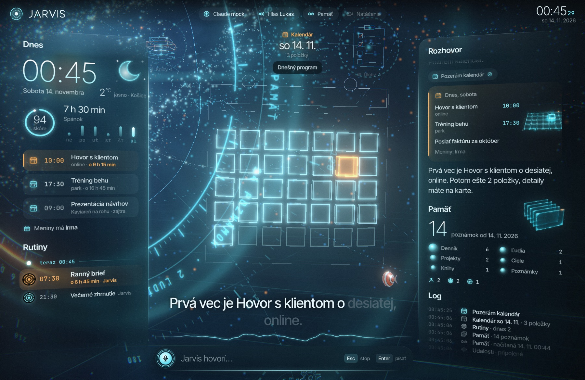

# Jarvis

Osobný AI asistent, ktorý ťa pozná, žije na tvojej ploche a sám sa ti ozýva. Postavený na Claude, beží na tvojom počítači.



## Ako začať

1. **Stiahni** tento priečinok (zelené tlačidlo *Code* → *Download ZIP*) a rozbaľ ho. Najlepšie do domovského priečinka, nie do Stiahnutých.
2. **Otvor ho v Claude.** V aplikácii Claude zvoľ kartu *Code* a vyber priečinok. Alebo v termináli: `cd jarvis-starter` a `claude`.
3. **Napíš `štart`.**

To je všetko. Claude spraví zvyšok: skontroluje počítač, sám si v ňom zistí, čo sa o tebe zistiť dá, a teba sa spýta len na to,
čo nenájde. Potom ti zapne Jarvisa na ploche a naučí ho pracovať samostatne. Trvá to asi pol hodiny a nemusíš vedieť programovať.

## Čo Jarvis robí

- **Zobudí ťa.** Povieš „zobuď ma o 6:30" a ráno zazvoní a povie ti nahlas, ako si spal (keď to vie), aké je počasie, čo ťa dnes čaká a čo spravil, kým si spal. Aj keď je jeho okno zatvorené.
- **Pozná ťa.** Pri nastavení si s tvojím súhlasom prejde počítač: poznámky, projekty, dokumenty, appky, hudbu, hry. Povie ti, čo zistil, a ty len opravíš, čo nesedí. Všetko si zapíše do priečinka `memory/` ako obyčajné textové súbory, ktoré vieš kedykoľvek otvoriť a upraviť.
- **Je tvoj druhý mozog.** Ukáže ti krok za krokom, ako si stiahnuť svoje dáta z Instagramu, WhatsAppu, Messengera, Discordu, ChatGPT, Spotify a ďalších. Export pretiahneš do jeho okna. Prečíta si rozhovory, spýta sa, kto je kto, a odvtedy vie odpovedať na „čo sme si písali s Janou o dovolenke?".
- **Žije na ploche.** HUD je obrazovka s 3D svetom tvojej pamäte: ľudia, projekty, ciele, kalendár, denník. Píšeš mu alebo podržíš medzerník a hovoríš. Odpovedá hlasom.
- **Pamätá si.** Povieš „zapamätaj si, že sestra má v máji narodeniny" a o pol roka ti to pripomenie. Večer si sám zapíše, čo sa cez deň dialo.
- **Pracuje sám.** Ráno ti pripraví prehľad dňa. Cez deň sám pripomenie, čo si chcel, a upozorní pred udalosťou v kalendári. Stráži poštu a ozve sa, len keď prišlo niečo dôležité. Večer zhrnie deň do denníka. Keď mu povieš „zisti mi…" alebo „cez noc mi priprav…", pracuje na pozadí a ozve sa, keď je hotový. Čo dorobí v noci, povie ti ráno.
- **Zavolá ti.** Keď niečo nepočká, zazvoní ti mobil a Jarvis ti to povie. Odpovieš mu hlasom a on to zariadi.
- **Rastie.** Keď vyjde nová verzia, sám sa ozve a po tvojom súhlase ju nainštaluje tak, aby ti ostali tvoje úpravy.
- **Je tvoj.** Žiadny server, žiadna databáza v cloude, žiadne API kľúče. Beží na tvojom predplatnom Claude a tvoje dáta ostávajú u teba.

## Čo potrebuješ

- Mac alebo počítač s Windows 10/11
- Predplatné Claude (Pro alebo Max)
- [Claude Code](https://claude.com/claude-code) a [Node.js](https://nodejs.org) 20 alebo novší. Ak ich nemáš, `štart` ti ich pomôže nainštalovať.
- Chrome alebo Edge na hlasové ovládanie

## Čo je v priečinku

| | |
|---|---|
| `CLAUDE.md` | Návod pre Clauda: celé nastavenie krok za krokom a ako sa má Jarvis správať. |
| `memory/` | Tvoja pamäť. Formáty sú v [`memory/README.md`](memory/README.md). |
| `hud/` | HUD: server, obrazovka a appka na plochu pre macOS. |
| `routines/` | Zadania rutín: ranný brief, večerné zhrnutie, týždenný prehľad, stráž pošty. |
| `scripts/` | Pomocné príkazy: kontrola počítača, prehľadanie počítača, import dát, štart HUD, rutiny, pulz, hovory, aktualizácie. |
| `docs/` | [Hlas](docs/HLAS.md), [Windows](docs/WINDOWS.md), [plocha Macu](docs/DESKTOP-MAC.md), [samostatnosť](docs/AUTONOMIA.md), [hovory](docs/HOVORY.md), [aktualizácie](docs/AKTUALIZACIE.md), [API](docs/API.md). |

## Príkazy, keby si ich chcel spustiť sám

```
node scripts/doctor.mjs             skontroluje, čo počítaču chýba
node scripts/hud.mjs                spustí Jarvisa na obrazovke
node scripts/scan.mjs               pozrie, čo sa o tebe dá zistiť z počítača (len číta)
node scripts/import.mjs run <súbor> naimportuje export dát (Instagram, WhatsApp, ChatGPT…)
node scripts/alarm.mjs set 06:30     budík (test = zazvoní hneď, off = vypne)
node scripts/job.mjs "…"            úloha na pozadí, aj na noc
node scripts/routine.mjs --list     zoznam rutín
node scripts/schedule.mjs install   zapne rutiny a pulz v systéme
node scripts/schedule.mjs remove    vypne ich
node scripts/call.mjs --test        skúšobný hovor na tvoj mobil
node scripts/update.mjs check       pozrie, či je nová verzia
```

## Súkromie

Pamäť, nastavenia a záznam rozhovorov sú len vo tvojom počítači a do gitu sa neukladajú. Von idú iba tieto veci:
tvoje správy Claudovi (cez tvoje predplatné, rovnako ako keď píšeš v Claude), text viet na syntézu hlasu (Microsoft Edge TTS),
dopyt na počasie pre tvoje mesto (Open-Meteo) a pri predvolenom rozpoznávaní reči zvuk z mikrofónu do služby prehliadača.
Hlas aj rozpoznávanie sa dajú prepnúť na čisto lokálne, pozri [docs/HLAS.md](docs/HLAS.md).

Prehľadanie počítača aj import exportov bežia celé v tvojom počítači. Exporty sa nikam neposielajú, Claude z nich číta len výťahy, keď si ľudí potvrdíš.
Jarvis počúva len na tvojom počítači: z iného zariadenia ani z cudzej webovej stránky sa k nemu nedá dostať.
Ak si zapneš hovory, text hovoru a tvoja nahratá odpoveď idú cez tvoj účet Twilio ([docs/HOVORY.md](docs/HOVORY.md)).
Kontrola aktualizácií sa pýta GitHubu na číslo najnovšej verzie a nič o tebe neposiela.

## Licencia

MIT. Rob si s tým, čo chceš.

---

## English

Jarvis is a personal AI assistant built on Claude Code. It runs on your own computer and your own Claude subscription:

- **Memory**: a local folder of markdown notes about your life (people, projects, goals, daily log), built during a guided interview and kept up to date by Jarvis itself.
- **HUD**: a full-screen desktop interface with a 3D world of that memory, voice in and out, and a chat with Claude.
- **Alarm clock**: at the set time Jarvis plays a chime and speaks a morning brief through the computer's speakers (sleep when known, weather, calendar, deadlines, what he did overnight), prepared by Claude a few minutes ahead, with a no-LLM fallback. Works with the HUD closed.
- **Routines**: scheduled headless Claude Code runs (launchd on macOS, Task Scheduler on Windows), such as a morning brief and an evening summary that writes the day into memory, plus a pulse every few minutes (no LLM) for reminders, upcoming events and deadlines.
- **Second brain**: a read-only scan of the computer during setup, an animated guide for requesting data exports (Instagram, Facebook, WhatsApp, Discord, Telegram, ChatGPT, Claude, Spotify and more), local importers, and a review screen where you confirm who is who.
- **Phone calls**: when something cannot wait, Jarvis rings your mobile through your own Twilio account, says it, and acts on your spoken answer. No inbound access to your computer is needed.
- **Updates**: a three-way updater that keeps your own changes and lets Claude merge real conflicts.

### Quick start

1. Download this folder.
2. Open it in Claude (the *Code* tab of the Claude app, or run `claude` in the folder).
3. Type `štart` (or `start`).

Claude does the setup for you: prerequisites, a scan of your computer that builds the memory (you only confirm and correct), the desktop HUD and the scheduled routines. The onboarding dialogue and the UI are in Slovak; ask Claude to continue in your language if you prefer.

### Requirements

macOS or Windows 10/11, a paid Claude plan (Pro or Max), Claude Code, Node.js 20+. Chrome or Edge for voice input. Optional: [`uv`](https://docs.astral.sh/uv/) for the neural voice.

### For developers

```
npm install
npm start                 # HUD server on http://localhost:4545
JARVIS_MOCK=1 npm start   # without Claude, mock answers
npm run doctor            # environment check
```

No build step, no database, no API keys. The server is plain Node (`hud/server.mjs`), the front end is vanilla JS with Three.js, the brain is a warm `claude -p` process with three small MCP servers (`hud/server/mcp/`). See [docs/API.md](docs/API.md).

License: MIT.
